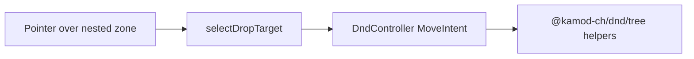

# Plan 002: Ship `@kamod-ch/dnd/tree` with nested drop-target engine fix

> **Executor instructions**: Follow this plan step by step. Run every
> verification command and confirm the expected result before moving to the
> next step. If anything in the "STOP conditions" section occurs, stop and
> report — do not improvise. When done, update the status row for this plan
> in `plans/README.md` — unless a reviewer dispatched you and told you they
> maintain the index.
>
> **Drift check (run first)**:
> `git diff --stat HEAD -- docs/tree-evaluation.md spikes/tree-spike packages/core/src/engine/pragmatic/bindings.ts`
> Compare the "Current state" excerpts against live code before proceeding; on
> mismatch, treat it as a STOP condition. Confirm Plan 001 is **DONE** in
> `plans/README.md` and that `docs/tree-evaluation.md` recommends **GO WITH
> CORE EXTENSION**.

## Status

- **Priority**: P2
- **Effort**: L (roughly 3–5 days; production subpath + engine change + E2E/docs)
- **Risk**: MED–HIGH (engine targeting affects all consumers)
- **Depends on**: Plan 001 (DONE; GO WITH CORE EXTENSION)
- **Category**: feature
- **Planned at**: 2026-10-19

## Why this matters

Plan 001 proved that **`MoveIntent` is sufficient** for tree mutations when each
parent’s ordered children are modeled as a container id, but **pointer reparent
into nested child drop zones failed** because the engine always uses
`location.current.dropTargets[0]`. Shipping trees without fixing that would
force consumers to rely on keyboard-only reparent or brittle workarounds.

This plan adds a **`@kamod-ch/dnd/tree` subpath** (pure helpers + types) and a
**narrow engine change** so container-per-parent Preact trees work with pointer
and keyboard, while **flat list MVP behavior stays unchanged**.

## Current state

Decision input: [`docs/tree-evaluation.md`](../docs/tree-evaluation.md) — **GO
WITH CORE EXTENSION**.

Reference implementation (spike, not published):

- [`spikes/tree-spike/src/model.ts`](../spikes/tree-spike/src/model.ts) —
  `treeToContainers`, `applyTreeMove`, `validateTreeMove`, `projectKeyboardMove`.
- [`spikes/tree-spike/e2e/tree.spec.ts`](../spikes/tree-spike/e2e/tree.spec.ts) —
  pointer case currently expects **no** reparent (`c2` stays under `rA` after
  `dragTo` `children-c1`); must flip to **success** after engine fix.

Engine excerpt to change
([`packages/core/src/engine/pragmatic/bindings.ts`](../packages/core/src/engine/pragmatic/bindings.ts)):

```ts
onDrag: ({ location }) => {
  const target = location.current.dropTargets[0];
  // ...
};
```

Package exports today ([`packages/core/package.json`](../packages/core/package.json)):

- `"."` and `"./sortable"` only; no `"./tree"`.

Architecture (unchanged contract):



**Invariants for this plan:**

- Do **not** change `MoveIntent` fields or semantics.
- Do **not** add tree options to `useSortable` / `useSortableContainer`.
- Domain tree shape remains application-owned; the package ships **helpers**,
  not a forced normalized store.
- Target index remains **after source removal**.

## Commands you will need

| Purpose               | Command                                                                                                                 | Expected on success                             |
| --------------------- | ----------------------------------------------------------------------------------------------------------------------- | ----------------------------------------------- |
| Core unit tests       | `pnpm --filter @kamod-ch/dnd test`                                                                                      | all Vitest tests pass (includes new tree tests) |
| Workspace typecheck   | `pnpm typecheck`                                                                                                        | exit 0                                          |
| Workspace lint        | `pnpm lint`                                                                                                             | exit 0                                          |
| List E2E regression   | `pnpm test:browser`                                                                                                     | all Playwright tests pass (editor + kanban)     |
| Tree E2E              | `pnpm --filter @kamod-dnd/spike-tree test:e2e` **or** new example E2E                                                   | pointer reparent case passes                    |
| Core build            | `pnpm --filter @kamod-ch/dnd build`                                                                                     | exit 0; `dist/tree.js` present                  |
| Pack smoke (optional) | `node scripts/qa-tarball-consumer.mjs`                                                                                  | exit 0; `./tree` import resolves                |
| Scoped format         | `pnpm exec oxfmt --check packages/core/src/tree packages/core/tests/tree*.ts plans/002-tree-subpath.md plans/README.md` | exit 0                                          |

## Scope

**In scope:**

- `packages/core/src/engine/pragmatic/bindings.ts` — drop-target selection
  (extract helper, e.g. `pickActiveDropTarget(dropTargets)`), preferring the
  **most specific** target consistent with list behavior:
  - When both item and container targets are present, preserve existing
    **item edge** behavior for flat lists (Kanban/editor must not regress).
  - When pointer is over a **nested container** drop zone (empty or not),
    select that **container** target so `overContainerId` matches the intended
    parent (spike case: reparent `c2` under `c1`).
- `packages/core/tests/` — unit tests for `pickActiveDropTarget` (or equivalent)
  with synthetic `dropTargets` arrays (no DOM required).
- `packages/core/src/tree/` — production tree helpers ported/adapted from spike:
  - Types: `TreeNode`, `TreeState`, `TreeMoveResult`, `TreeKeyboardAction`.
  - Functions: `treeToContainers`, `treeFromContainers`, `parentOf`,
    `descendantIds`, `validateTreeMove`, `applyTreeMove`, `projectKeyboardMove`.
  - Export **`DEFAULT_ROOT_CONTAINER_ID`** (or document that callers pass root
    id) — spike used `__tree_root__`; production API should name this clearly.
- `packages/core/src/index.ts` — re-export tree module **or** separate entry only
  via `./tree` (prefer separate entry to keep root bundle lean).
- `packages/core/package.json` — add `"./tree"` export (mirror `./sortable`:
  `dist/tree.js` + types).
- `packages/core/tsup.config.ts` / build script — emit `dist/tree.js`.
- `packages/core/tests/tree.test.ts` — port cases from
  `spikes/tree-spike/src/model.test.ts`.
- `spikes/tree-spike/src/model.ts` — thin re-export from `@kamod-ch/dnd/tree`
  **or** delete duplicate logic and import package (spike stays demo).
- `spikes/tree-spike/e2e/tree.spec.ts` — update pointer test to expect reparent
  success after engine fix.
- `examples/tree/` (create) **or** extend spike as CI-visible example — Vite +
  Preact, imports `@kamod-ch/dnd/tree`, registered in workspace; optional if
  spike E2E remains the browser gate (pick one; document in plan execution notes).
- [`packages/docs`](../packages/docs/) — one doc page or section: install
  `@kamod-ch/dnd/tree`, container-per-parent pattern, link to spike/example.
- Root [`README.md`](../README.md) — move trees from "Not in MVP" to
  **opt-in subpath** `@kamod-ch/dnd/tree`; keep touch/SR caveats.
- `docs/tree-evaluation.md` — short addendum: "Plan 002 shipped …" with date
  and pointer retest result (do not delete spike history).
- `plans/README.md` — status **DONE** when complete.

**Out of scope:**

- Auto-expand on drag hover, virtualization, grids, flattened visible-row trees,
  multi-select, file/cross-window DnD.
- New localized message keys for reparent (optional follow-up); indent/outdent
  announcements can reuse generic "moved" until copy exists.
- Manual VoiceOver/NVDA/iOS/Android certification — list under
  `docs/a11y-manual-checklist.md` as still required before marketing "full a11y".
- npm publish / version bump unless operator explicitly requests release.
- Changing `KeyboardMoveAction` in core for indent/outdent (stay in tree helper).

## Git workflow

- Branch: `feature/002-dnd-tree-subpath`
- Commit in logical chunks: (1) engine + tests, (2) tree module + exports,
  (3) spike/example + E2E, (4) docs/README/plans.
- Do not push or open PR unless instructed.

## Steps

### Step 1: Engine — nested drop-target precedence

1. Add `pickActiveDropTarget(dropTargets)` (name may vary) in
   `packages/core/src/engine/pragmatic/` (same file or `drop-target.ts`).
2. Rules (document in code comment + unit tests):
   - Flat list: item targets with closest edge behave as today.
   - Nested tree: when a **container** target is among candidates and pointer
     interaction is over that container’s element (including empty child zones),
     prefer the **deepest matching container** or the container over a sibling
     item when that matches spike reproducer — **verify against pragmatic
     `dropTargets` ordering**; do not guess without test vectors.
3. Wire `onDrag` to use the helper instead of `[0]`.
4. Add Vitest cases mirroring: Kanban-like (item edge wins), tree-like (container
   wins for nested zone).

**Verify:**

```bash
pnpm --filter @kamod-ch/dnd test
pnpm test:browser
```

Expected: all existing tests green; new engine unit tests pass.

### Step 2: `@kamod-ch/dnd/tree` module

1. Create `packages/core/src/tree/` from spike logic; import
   `applyMoveIntentToIds` from sortable internals (same pattern as spike).
2. Export public API from `packages/core/src/tree/index.ts`.
3. Update build to emit `dist/tree.js`; add `package.json` export `"./tree"`.
4. Port `spikes/tree-spike/src/model.test.ts` → `packages/core/tests/tree.test.ts`.

**Verify:**

```bash
pnpm --filter @kamod-ch/dnd build
pnpm --filter @kamod-ch/dnd test
```

Expected: `dist/tree.js` exists; tree tests pass; spike can import
`@kamod-ch/dnd/tree`.

### Step 3: Spike / example and browser proof

1. Point spike model at `@kamod-ch/dnd/tree` (remove duplication).
2. Flip E2E pointer test: after `dragTo` nested child zone, `c2` parent is `c1`,
   last intent accepted.
3. Optionally add `examples/tree` and register in root scripts — if skipped,
   document spike as the browser reference.

**Verify:**

```bash
pnpm --filter @kamod-dnd/spike-tree test:e2e
```

Expected: 5/5 pass including pointer reparent.

### Step 4: Documentation

1. README: document `./tree` subpath and limitations (touch/SR manual).
2. PreactPress docs: short guide + link to example/spike.
3. Append Plan 002 outcome to `docs/tree-evaluation.md`.

**Verify:**

```bash
pnpm docs:build
pnpm exec oxfmt --check packages/core/src/tree packages/core/tests/tree.test.ts plans/002-tree-subpath.md plans/README.md
```

### Step 5: Final gate

```bash
pnpm check
pnpm test:browser
pnpm --filter @kamod-dnd/spike-tree test:e2e
node scripts/qa-tarball-consumer.mjs
```

Update `plans/README.md` → Plan 002 **DONE**.

## Test plan

- **Engine unit tests**: synthetic `dropTargets` — list item precedence unchanged;
  nested container precedence matches tree spike fixture.
- **Tree module tests** (from spike): sibling reorder, root ↔ child, empty child
  list, subtree preservation, cycle rejection, source mismatch, immutability,
  indent/outdent projection.
- **Regression**: full `pnpm test:browser` (editor + kanban, 3 browsers).
- **Tree browser**: spike E2E indent/outdent/empty child/cycle/pointer/ARIA.

## Done criteria

- [x] `pickActiveDropTarget` (or equivalent) replaces blind `[0]` with tested rules.
- [x] `@kamod-ch/dnd/tree` export published in package.json and built to `dist/tree.js`.
- [x] Tree Vitest suite in `packages/core/tests/`.
- [x] Pointer reparent E2E passes (nested child zone).
- [x] Kanban/editor E2E unchanged (pass).
- [x] README and docs describe opt-in tree subpath; no false SR/touch claims.
- [x] `docs/tree-evaluation.md` addendum records engine fix + retest.
- [x] Plan 002 status **DONE** in `plans/README.md`.

## STOP conditions

Stop and report; do not improvise if:

- Plan 001 is not DONE or evaluation is not GO WITH CORE EXTENSION.
- Engine change breaks Kanban/editor E2E and cannot be fixed without redesigning
  flat list targeting.
- Pragmatic `dropTargets` ordering differs by browser in ways that cannot be
  covered by deterministic unit tests — document and escalate (may need ADR).
- Implementing trees requires changing `MoveIntent` shape — stop; new plan required.
- Any step verification fails twice after one reasonable fix attempt.

## Maintenance notes

- Flattened-row tree UIs are **not** validated by Plan 001/002; a future plan
  must address horizontal depth and collision separately.
- After this plan, a release plan should bump version, changelog, and npm publish.
- Keep `spikes/tree-spike` as a lightweight regression fixture unless
  `examples/tree` replaces it in CI.
